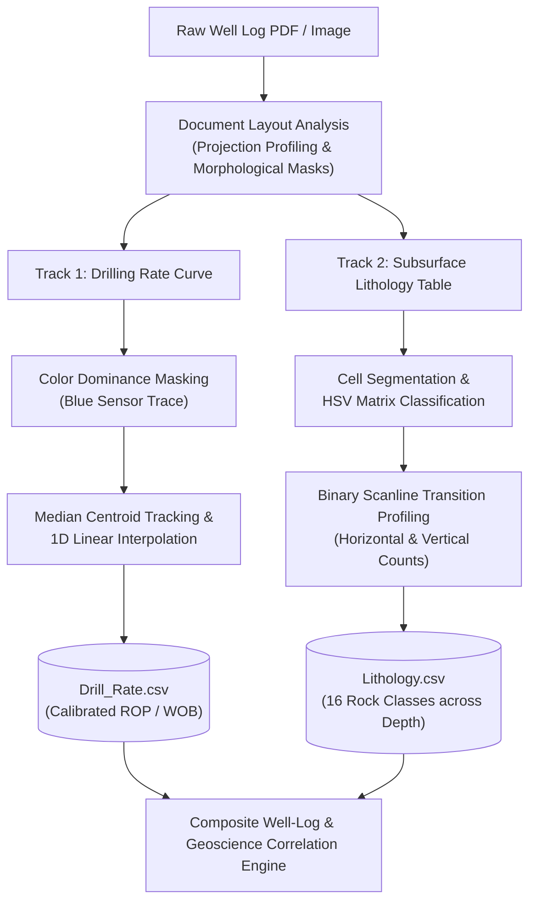
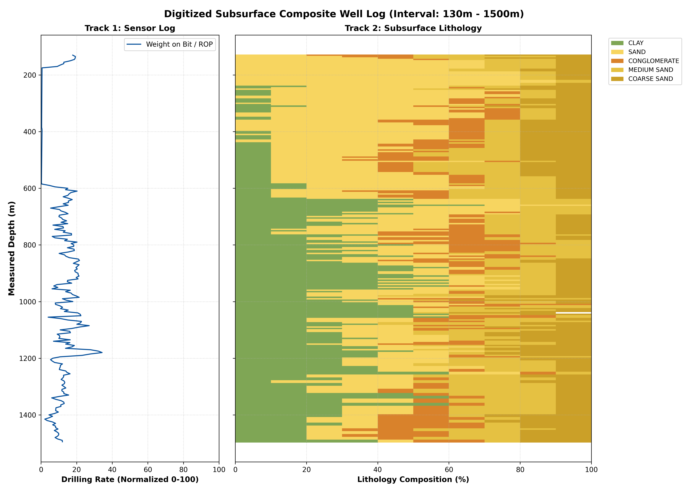
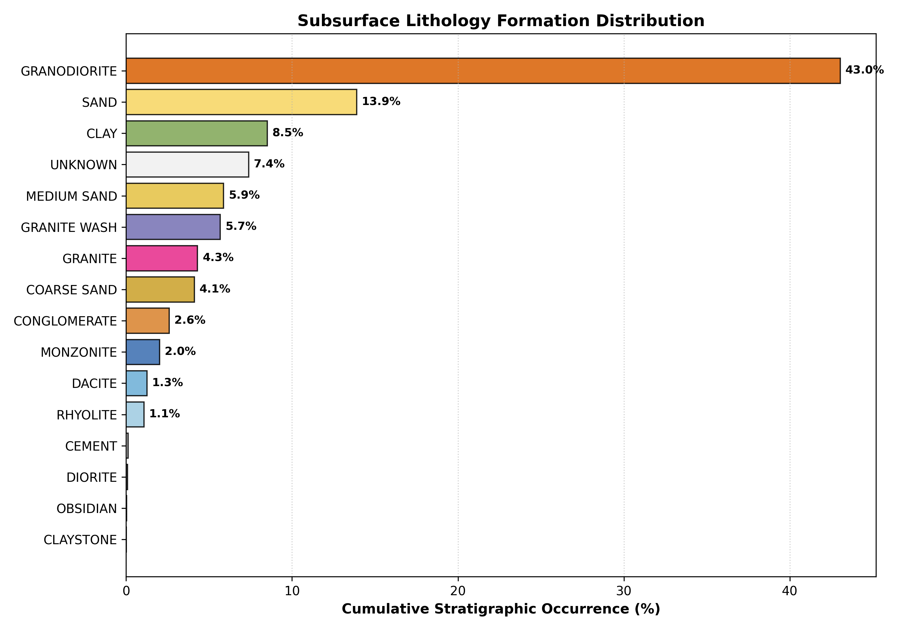
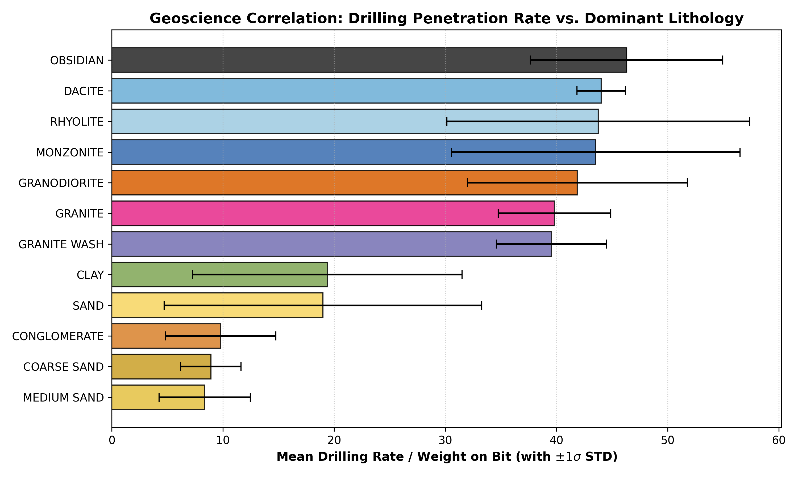

# Subsurface Lithology Extraction & Well-Log Curve Digitization via Computer Vision

[](https://www.python.org/)
[](https://opencv.org/)
[](https://pandas.pydata.org/)
[](#geological-symbol-recognition-engine)
[](LICENSE)

An automated document intelligence and computer vision pipeline designed to parse, digitize, and classify complex graphical **subsurface mud-logging and well-drilling reports**. The system combines directional morphological projection profiling, HSV color-space background/foreground segmentation, and scanline transition analysis to extract geological rock formations and continuous drilling dynamics (Weight on Bit / Rate of Penetration) across deep stratigraphic intervals.

---

## Table of Contents
- [Industrial Background & Challenges](#industrial-background--challenges)
- [Pipeline Architecture](#pipeline-architecture)
- [Methodology & Algorithmic Formulation](#methodology--algorithmic-formulation)
  - [1. Document Layout Analysis & Table Segmentation](#1-document-layout-analysis--table-segmentation)
  - [2. Geological Symbol Recognition Engine](#2-geological-symbol-recognition-engine)
  - [3. Continuous Well-Log Curve Tracking](#3-continuous-well-log-curve-tracking)
- [Digitized Dataset & Stratigraphic Analytics](#digitized-dataset--stratigraphic-analytics)
- [Visual Results Gallery](#visual-results-gallery)
- [Repository Structure](#repository-structure)
- [Quick Start Guide](#quick-start-guide)

---

## Industrial Background & Challenges
Subsurface energy exploration relies heavily on historical technical mud logs. These documents feature:
- Multi-track layouts combining tabular geological symbols with continuous analog sensor curves.
- Intricate graphic rock patterns overlaid on textured or colored matrix backgrounds.
- High vertical aspect ratios ($10,000+\text{ pixels}$) spanning thousands of meters of depth.

This pipeline automates the digitization lifecycle, converting static document images into structured CSV time-series and lithological databases ready for reservoir modeling and machine learning.



---

## Methodology & Algorithmic Formulation

### 1. Document Layout Analysis & Table Segmentation
- **Directional 1D Projection Profiling:** Detects continuous horizontal and vertical divider lines:
  $$P_h(y) = \sum_{x=0}^{W-1} I_{\text{bw}}(x, y), \quad P_v(x) = \sum_{y=0}^{H-1} I_{\text{bw}}(x, y)$$
- **Morphological Grid Extraction:** Decomposes the table structure using orthogonal rectangular structuring elements:
  $$M_h = ((I \oplus B_{\text{rect}}) \ominus B_{3\times 1}) \ominus B_{1\times 3}, \quad M_v = (I \oplus B_{\text{rect}}) \ominus B_{1\times 3}$$

### 2. Geological Symbol Recognition Engine
Identifies **16 distinct geological rock formations** (Obsidian, Sand, Clay, Granite Wash, Conglomerate, Monzonite, Dacite, Rhyolite, etc.) across 2,172 depth intervals:
1. **Background Matrix Classification:** Evaluates median HSV color:
   - **Black Matrix ($V \le 60$):** Classified as `OBSIDIAN`.
   - **Yellow Matrix ($H \in [15, 40], S \ge 70, V \ge 120$):** Classified into granular sandstone variants via vertical transition profiling:
     $$T_v = \max_x \sum_y |\Delta I_{\text{bin}}(x, y)|$$
     - $T_v = 2$: `SAND`, `MEDIUM SAND`, or `COARSE SAND` (partitioned by foreground binary area).
     - $T_v = 4$: `CONGLOMERATE`.
   - **White Matrix:** Segmented via foreground line stroke color:
     - **Blue Strokes:** `MONZONITE` ($T_v = 2$) vs. `DACITE` ($T_v > 2$).
     - **Red Strokes:** `GRANODIORITE` ($T_h = 2$) vs. `GRANITE` ($T_h > 2$).
     - **Green Strokes:** `CLAY`, `CLAYSTONE`, `RHYOLITE`, or `GRANITE WASH` via 2D orthogonal transition matrices.
     - **Black Strokes:** `DIORITE` vs. `CEMENT`.

### 3. Continuous Well-Log Curve Tracking
- **Color Dominance Filtering:** Isolates the high-frequency drilling curve:
  $$\text{Mask}_{\text{blue}} = (I_B > 120) \wedge (I_R < 50) \wedge (I_G < 50)$$
- **Centroid Tracking:** Calculates the median spatial horizontal coordinate for each scanline row $y$:
  $$\bar{x}(y) = \operatorname{median}\left(\{x \mid \text{Mask}_{\text{blue}}(x, y) = 1\}\right)$$
- **Occlusion Handling:** Fills missing depth intervals through piecewise 1D linear interpolation ($\operatorname{interp}(y)$).
- **Physical Calibration:** Maps pixel coordinates to calibrated engineering units ($0 - 100$).

---

## Digitized Dataset & Stratigraphic Analytics
- **Total Depth Span:** $130\text{ m}$ to $10,990\text{ m}$.
- **Resolution:** Uniform $5\text{ m}$ stratigraphic logging intervals (**2,172 depth steps**).
- **Dominant Formations:** Granodiorite (44.6%), Sandstone (14.4%), Clay (8.8%), Medium Sand (6.1%), Granite Wash (5.9%), Granite (4.5%).

---

## Visual Results Gallery

| Pipeline Output | High-Resolution Geological Chart |
| :--- | :--- |
| **Composite Well Log** |  |
| **Formation Composition Breakdown** |  |
| **Geoscience Correlation Cross-Plot** |  |

---

## Repository Structure

```
12_Subsurface_Lithology_Computer_Vision/
├── data/
│   ├── Lithology.csv                           # Extracted subsurface lithology table (2,172 depth rows)
│   └── Drill_Rate.csv                          # Digitized continuous drilling penetration rate / WOB
├── docs/
│   └── MV_Project_Report_FA.pdf                # Original 22-page LaTeX technical project report
├── notebooks/
│   ├── Well_Log_Lithology_Digitization.ipynb  # Interactive walkthrough with English annotations
│   └── Original_MV_Project_Colab.ipynb         # Original Google Colab execution history
├── results/
│   ├── stratigraphic_lithology_log.png         # Dual-track composite well log chart
│   ├── lithology_composition_overview.png      # Formation distribution overview
│   └── drillrate_vs_lithology_correlation.png  # Penetration rate vs. lithology correlation
├── src/
│   ├── __init__.py
│   ├── document_layout.py                      # Projection profile & table grid extraction
│   ├── symbol_classifier.py                    # HSV color space & transition pattern classifier
│   ├── curve_digitizer.py                      # Continuous curve segmentation & calibration
│   └── visualizer.py                           # Geological log & cross-plot rendering engine
├── run_pipeline.py                             # Master CLI pipeline runner
├── requirements.txt
├── .gitignore
└── README.md
```

---

## Quick Start Guide

### Installation
```bash
git clone https://github.com/<your-username>/12_Subsurface_Lithology_Computer_Vision.git
cd 12_Subsurface_Lithology_Computer_Vision
pip install -r requirements.txt
```

### Running the Analysis Pipeline
```bash
python run_pipeline.py
```

### Exploring the Interactive Notebook
```bash
jupyter notebook notebooks/Well_Log_Lithology_Digitization.ipynb
```
